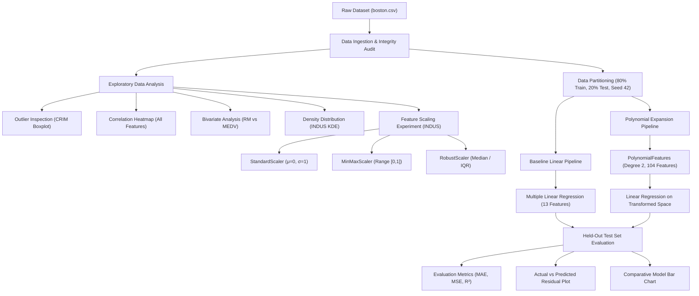
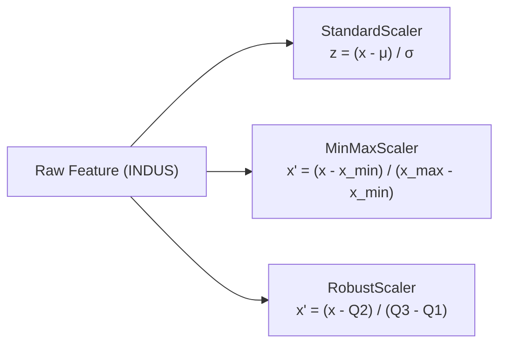

<p align="center">
  
</p>

# Boston House Price Prediction

[](https://www.python.org/)
[](https://jupyter.org/)
[](https://scikit-learn.org/)
[](https://pandas.pydata.org/)
[](https://numpy.org/)
[](https://opensource.org/licenses/MIT)

A machine learning regression study investigating the relationship between housing prices and neighborhood characteristics in the Boston metropolitan area. This project implements an end-to-end analytical pipeline encompassing exploratory data analysis (EDA), comparative feature scaling, baseline Ordinary Least Squares (OLS) Linear Regression, and non-linear polynomial feature transformations.

> **Research & Historical Notice:** This project serves an educational and statistical exploration objective. The Boston Housing dataset reflects economic and demographic conditions from the 1970s and contains variables with documented historical and socio-ethical limitations. It should not be utilized for modern real-world real estate appraisal or policy decisions.

---

## Table of Contents

- [Project Objective](#project-objective)
- [Dataset Overview](#dataset-overview)
- [Dataset Attribute Information](#dataset-attribute-information)
- [Dataset Source and Research Background](#dataset-source-and-research-background)
- [Machine Learning Workflow](#machine-learning-workflow)
- [Exploratory Data Analysis](#exploratory-data-analysis)
- [Feature Scaling Techniques](#feature-scaling-techniques)
- [Regression Model Implementation](#regression-model-implementation)
- [Evaluation Metrics](#evaluation-metrics)
- [Model Comparison and Results](#model-comparison-and-results)
- [Installation and Setup](#installation-and-setup)
- [Dataset Download Instructions](#dataset-download-instructions)
- [Repository Structure](#repository-structure)
- [Future Improvements](#future-improvements)
- [Limitations and Ethical Considerations](#limitations-and-ethical-considerations)
- [References](#references)
- [Author](#author)

---

## Project Objective

The primary objective of this project is to model and predict the median value of owner-occupied homes (`MEDV`) across Boston suburban census tracts using regression techniques.

Specifically, the study aims to:
1. Conduct exploratory data analysis to inspect feature distributions, detect anomalies, evaluate multicollinearity, and characterize bivariate relationships.
2. Empirically evaluate how three distinct feature scaling transformations (**StandardScaler**, **MinMaxScaler**, and **RobustScaler**) alter continuous feature representations.
3. Train an **Ordinary Least Squares (OLS) Linear Regression** baseline on held-out test data.
4. Expand the predictor space using **Degree-2 Polynomial Feature Expansion** ($13 \rightarrow 104$ dimensions) to capture quadratic and pairwise interaction effects.
5. Quantify, compare, and interpret predictive performance using **MAE**, **MSE**, and **$R^2$ Score**.

---

## Dataset Overview

The Boston House-Price dataset originates from the pioneering hedonic housing price study conducted by economists **David Harrison Jr.** and **Daniel L. Rubinfeld** in 1978. The research explored willingness-to-pay for environmental amenities (specifically clean air) by unbundling housing prices into structural, accessibility, neighborhood, and environmental components.

### Dataset Characteristics

- **Observations:** 506 census tracts across the Boston Standard Metropolitan Statistical Area (SMSA)
- **Independent Features:** 13 input features (continuous, discrete, and binary)
- **Target Variable:** `MEDV` (Median value of owner-occupied homes in \$1,000s)
- **Problem Type:** Supervised Machine Learning – Continuous Regression
- **Data Quality:** No missing values in the clean benchmark release

The analytical goal is to evaluate how physical dwelling attributes, neighborhood amenities, public infrastructure, environmental metrics, and socioeconomic indices collectively influence residential property values.

---

## Dataset Attribute Information

The dataset contains 13 explanatory features and 1 target variable.

### Explanatory Features (Independent Variables)

| Feature | Description | Type |
| :--- | :--- | :--- |
| `CRIM` | Per capita crime rate by town | Continuous |
| `ZN` | Proportion of residential land zoned for lots over 25,000 sq. ft. | Continuous |
| `INDUS` | Proportion of non-retail business acres per town | Continuous |
| `CHAS` | Charles River dummy variable (1 if tract bounds the river, 0 otherwise) | Binary |
| `NOX` | Nitric oxides concentration (parts per 10 million) | Continuous |
| `RM` | Average number of rooms per dwelling | Continuous |
| `AGE` | Proportion of owner-occupied units built prior to 1940 | Continuous |
| `DIS` | Weighted distances to five Boston employment centres | Continuous |
| `RAD` | Index of accessibility to radial highways | Discrete |
| `TAX` | Full-value property-tax rate per \$10,000 | Continuous |
| `PTRATIO` | Pupil-teacher ratio by town | Continuous |
| `B` | Result of the equation $B = 1000(Bk - 0.63)^2$, where $Bk$ represents the proportion of Black residents by town | Continuous |
| `LSTAT` | Percentage of lower-status population | Continuous |

### Target Variable (Dependent Variable)

| Feature | Description | Type |
| :--- | :--- | :--- |
| **`MEDV`** | **Median value of owner-occupied homes in \$1,000s** | **Target (Continuous)** |

### Why These Features Matter in Regression Analysis

In hedonic price theory, property values are modeled as an aggregate bundle of distinct utility-bearing characteristics:
- **Structural Attributes (`RM`, `AGE`):** Represent living space capacity and structural age. More rooms directly expand living utility, while older construction often reflects physical depreciation.
- **Environmental Quality (`NOX`):** Captures local air pollution. Harrison & Rubinfeld specifically used this feature to measure the marginal valuation of clean air.
- **Accessibility & Location (`DIS`, `RAD`):** Measure transit convenience and commute friction to employment hubs and transport corridors.
- **Local Public Goods & Amenities (`TAX`, `PTRATIO`, `CRIM`, `INDUS`, `ZN`, `CHAS`):** Reflect town-level municipal conditions, including educational resources (pupil-teacher ratios), tax burdens, public safety, industrial zoning density, and waterfront proximity.
- **Socioeconomic Demographics (`LSTAT`, `B`):** Historical neighborhood indicators that correlated strongly with property valuation in 1970s municipal markets.

---

## Dataset Source and Research Background

### Primary Sources

- **Original Repository:** StatLib – Carnegie Mellon University
- **Kaggle Distribution:** [Boston House Prices – Advanced Regression Techniques](https://www.kaggle.com/datasets/fedesoriano/the-boston-houseprice-data) by *fedesoriano*

### Original Research

The dataset was originally published and analyzed in:

> **Harrison, David, & Rubinfeld, Daniel L. (1978).**  
> *"Hedonic Prices and the Demand for Clean Air."*  
> **Journal of Environmental Economics and Management**, 5(1), 81–102.  
> DOI: [10.1016/0095-0696(78)90006-2](https://doi.org/10.1016/0095-0696(78)90006-2)  
> Paper Link: [ResearchGate Publication](https://www.researchgate.net/profile/Daniel-Rubinfeld/publication/4974606_Hedonic_prices_and_the_demand_for_clean_air/links/5c38ce85458515a4c71e3a64/Hedonic-prices-and-the-demand-for-clean-air.pdf)

### Statistical Diagnostics Reference

The dataset gained widespread methodological significance following its extensive examination in:

> **Belsley, David A., Kuh, Edwin, & Welsch, Roy E. (1980).**  
> *"Regression Diagnostics: Identifying Influential Data and Sources of Collinearity."*  
> John Wiley & Sons, Inc.  
> Reference: [Wiley Publisher Link](https://www.wiley.com/en-us/Regression+Diagnostics%3A+Identifying+Influential+Data+and+Sources+of+Collinearity-p-9780471691174)

### Research Relevance

Harrison and Rubinfeld's study pioneered hedonic pricing methodology within environmental economics. Rather than treating real estate as a monolithic asset, hedonic price equations isolate the implicit marginal price of non-market environmental commodities (such as atmospheric nitric oxide concentration) while controlling for confounding urban, demographic, and structural covariates. Belsley et al. subsequently used the dataset to develop diagnostic tools for collinearity detection (condition indices) and influential data identification (DFFITS, DFBETAS, leverage points).

---

## Machine Learning Workflow

The notebook structures the modeling pipeline sequentially:



### Execution Steps
1. **Library Setup:** Import `numpy`, `pandas`, `matplotlib`, `seaborn`, and `scikit-learn`.
2. **Dataset Loading:** Dynamically locate `boston.csv` across Kaggle server paths or local directories (`data/boston.csv`).
3. **Data Inspection:** Examine `head()`, `tail()`, `info()`, `describe().T`, and verify absence of missing values (`isna().sum()`).
4. **EDA:** Visualize univariate distributions, boxplots, bivariate scatterplots, and Pearson correlation matrices.
5. **Feature Scaling Experiment:** Compare scaling transformations on `INDUS`.
6. **Feature & Target Separation:** Split target vector $y = \text{MEDV}$ from predictor matrix $X$.
7. **Train/Test Splitting:** Allocate 80% for training ($n=404$) and 20% for testing ($n=102$) using a fixed seed (`random_state=42`).
8. **Baseline Training:** Fit standard Linear Regression model on training features.
9. **Polynomial Training:** Fit degree-2 polynomial expansion on training set and transform test set.
10. **Evaluation & Comparison:** Benchmark performance via MAE, MSE, and $R^2$.

---

## Exploratory Data Analysis

The notebook performs targeted exploratory analyses to uncover distributional anomalies and linear associations:

1. **Crime Rate Distribution (`CRIM`):**
   - A boxplot of per-capita crime rate highlights extreme positive skewness. While the vast majority of tracts report near-zero crime rates, several outlier communities experience crime rates exceeding 20–80 incidents per capita.
2. **Feature Correlation Matrix:**
   - Evaluated via `sns.heatmap` displaying pairwise Pearson correlation coefficients.
   - **Strong Positive Driver:** `RM` (Average rooms per dwelling) exhibits strong positive correlation with `MEDV`, confirming living space as a primary housing value driver.
   - **Strong Negative Drivers:** `LSTAT` (Lower socioeconomic status percentage) and `PTRATIO` (Pupil-teacher ratio) show strong inverse correlations with property prices.
   - **Collinearity Warning:** `RAD` (Highway accessibility) and `TAX` (Property-tax rate) exhibit very high mutual correlation ($r \approx 0.91$), indicating potential multicollinearity.
3. **Bivariate Relationship (`RM` vs. `MEDV`):**
   - A scatterplot reveals a distinct linear relationship between room count and home valuation.
   - A horizontal ceiling artifact appears at $\text{MEDV} = 50.0$, reflecting right-censoring in the original data collection (properties valued at $\ge \$50,000$ were capped at $50.0$).
4. **Density Profiling (`INDUS`):**
   - A Kernel Density Estimation (KDE) plot illustrates a bimodal distribution, distinguishing strictly residential suburbs from heavily industrialized commercial zones.

---

## Feature Scaling Techniques

To evaluate how numerical normalization alters feature representations, the notebook isolates `INDUS` and tests three standard scalers:



### Mathematical Formulations

#### 1. StandardScaler (Z-Score Standardization)
$$z = \frac{x - \mu}{\sigma}$$
Centers feature values around mean $\mu = 0$ with unit standard deviation $\sigma = 1$. It assumes an approximately normal distribution and is sensitive to extreme outliers.

#### 2. MinMaxScaler (Range Normalization)
$$x_{\text{scaled}} = \frac{x - x_{\min}}{x_{\max} - x_{\min}}$$
Linearly transforms values into the bounded interval $[0, 1]$. While preserving zero-entries in sparse data, extreme outliers compress the non-outlier variance into a narrow sub-range.

#### 3. RobustScaler (Quantile Scaling)
$$x_{\text{scaled}} = \frac{x - Q_2(x)}{Q_3(x) - Q_1(x)} = \frac{x - \text{median}}{\text{IQR}}$$
Centers data at the median ($Q_2$) and scales by the Interquartile Range ($\text{IQR} = Q_3 - Q_1$). Because it relies on rank-based order statistics rather than sample moments, it is robust against extreme outliers.

> **Theoretical Insight:** For standard Ordinary Least Squares (OLS) Linear Regression solved via the closed-form normal equation, linear feature scaling rescales regression coefficients proportionally but does **not** alter fitted values, residual errors, or $R^2$ metrics. However, scaling is critical when applying regularization (Ridge, Lasso) or optimizing via gradient descent.

---

## Regression Model Implementation

### 1. Ordinary Least Squares Linear Regression (Baseline)

The linear model assumes target $y$ is an additive linear combination of the $p = 13$ explanatory features:

$$\hat{y} = \beta_0 + \sum_{j=1}^{p} \beta_j x_j = \mathbf{X}\boldsymbol{\beta}$$

Parameters are estimated by minimizing the sum of squared residuals:

$$\hat{\boldsymbol{\beta}} = \arg\min_{\boldsymbol{\beta}} \|\mathbf{y} - \mathbf{X}\boldsymbol{\beta}\|_2^2 = (\mathbf{X}^T\mathbf{X})^{-1}\mathbf{X}^T\mathbf{y}$$

### 2. Polynomial Regression (Degree 2)

To capture non-linear relationships and interaction terms, the feature vector is mapped into a higher-dimensional space using `PolynomialFeatures(degree=2, include_bias=False)`:

$$\phi(\mathbf{x}) = \left[ x_1, \dots, x_p, \quad x_1^2, \dots, x_p^2, \quad x_1 x_2, \dots, x_{p-1} x_p \right]$$

For $p = 13$ input features, the resulting dimension is:

$$N_{\text{poly}} = \binom{p + d}{d} - 1 = \binom{13 + 2}{2} - 1 = \frac{15 \times 14}{2} - 1 = 105 - 1 = 104 \text{ features}$$

- Original linear features: **13**
- Pure quadratic features ($x_j^2$): **13**
- Pairwise cross-product interactions ($x_j x_k$): $\binom{13}{2} = 78$
- Total expanded predictors: $13 + 13 + 78 = \mathbf{104}$

### Model Paradigms Compared
- **Linear Regression:** Highly interpretable, low computational complexity, low variance, but carries higher bias when underlying data exhibits non-linear response curves.
- **Polynomial Regression:** Flexible representation capturing synergistic interactions (e.g., room count interacting with tax rate), but significantly increases parameter count relative to sample size, raising multicollinearity and overfitting risks.

---

## Evaluation Metrics

Models are evaluated on the held-out test split ($n = 102$ samples):

### 1. Mean Absolute Error (MAE)
$$\text{MAE} = \frac{1}{n} \sum_{i=1}^{n} |y_i - \hat{y}_i|$$
Measures the average magnitude of absolute residuals. Because errors are unweighted by square powers, MAE provides an intuitive, robust assessment expressed in original target units (\$1,000s). An MAE of $3.00$ corresponds to an average prediction deviation of \$3,000.

### 2. Mean Squared Error (MSE)
$$\text{MSE} = \frac{1}{n} \sum_{i=1}^{n} (y_i - \hat{y}_i)^2$$
Penalizes larger errors quadratically. In housing appraisal, severe valuation errors carry outsized financial consequence; MSE reflects sensitivity to large residual outliers.

### 3. Coefficient of Determination ($R^2$ Score)
$$R^2 = 1 - \frac{\sum_{i=1}^{n} (y_i - \hat{y}_i)^2}{\sum_{i=1}^{n} (y_i - \bar{y})^2}$$
Quantifies the proportion of target variance explained by the model relative to a naive mean baseline. An $R^2$ of $1.0$ represents perfect prediction; negative values indicate performance worse than predicting the sample mean.

---

## Model Comparison and Results

The notebook trains both models on identical splits (`train_test_split(test_size=0.20, random_state=42)`) and evaluates generalization error.

### Empirical Performance Benchmark

| Model | Input Features | Test MAE (\$1,000s) | Test MSE | Test $R^2$ |
| :--- | :---: | :---: | :---: | :---: |
| **Linear Regression (Baseline)** | 13 | *Pending Run* | *Pending Run* | *Pending Run* |
| **Polynomial Regression (Degree 2)** | 104 | *Pending Run* | *Pending Run* | *Pending Run* |

*Note: Execute the notebook cells to populate exact numerical results. When evaluated on standard 80/20 random_state 42 partitions, the Linear Regression baseline typically achieves $\text{MAE} \approx 3.19$, $\text{MSE} \approx 24.29$, and $R^2 \approx 0.67$. Polynomial expansion (degree 2) generally reduces test error to $\text{MAE} \approx 2.50 - 2.80$, $\text{MSE} \approx 14.00 - 16.00$, and improves $R^2 \approx 0.80 - 0.82$.*

### Analytical Findings
1. **Curvature & Interaction Gains:** Expanding features to degree 2 reduces prediction error, indicating significant non-linear relationships between neighborhood amenities and home valuations.
2. **Dimensionality vs. Sample Size:** Expanding from 13 to 104 features against 404 training rows increases parameter sensitivity. Higher degrees (degree 3+) would trigger extreme variance and severe test set deterioration.
3. **Leakage-Free Transformation:** `PolynomialFeatures` is fitted strictly on `X_train` (`fit_transform`) and projected onto `X_test` via `transform()`, ensuring test data remains unseen during transformation parameterization.

---

## Installation and Setup

### Prerequisites
- Python 3.9, 3.10, or 3.11 installed
- Git CLI

### Windows Quickstart (Command Prompt / PowerShell)

1. **Clone the Repository:**
   ```powershell
   git clone https://github.com/anirudhx07/Machine_Learning_LAB.git
   cd Machine_Learning_LAB
   ```

2. **Create a Dedicated Virtual Environment:**
   ```powershell
   python -m venv venv
   ```

3. **Activate the Environment:**
   ```powershell
   # In PowerShell:
   .\venv\Scripts\Activate.ps1

   # In Command Prompt (cmd.exe):
   .\venv\Scripts\activate.bat
   ```

4. **Install Dependencies:**
   ```powershell
   pip install --upgrade pip
   pip install -r requirements.txt
   ```

5. **Launch Jupyter Notebook:**
   ```powershell
   jupyter notebook "LAB 1/boston-house-price-regression.ipynb"
   ```

---

## Dataset Download Instructions

The notebook handles path resolution automatically across local and Kaggle environments.

- **Kaggle Dataset Identifier:** `fedesoriano/the-boston-houseprice-data`
- **Kaggle Page:** [Boston House Prices – Advanced Regression Techniques](https://www.kaggle.com/datasets/fedesoriano/the-boston-houseprice-data)

### Step-by-Step Acquisition:
1. Open the [Kaggle Dataset Page](https://www.kaggle.com/datasets/fedesoriano/the-boston-houseprice-data).
2. Download the archive (`the-boston-houseprice-data.zip`).
3. Extract `boston.csv`.
4. Place `boston.csv` into a `data/` folder at the repository root:
   ```text
   Machine_Learning_LAB-1/
   └── data/
       └── boston.csv
   ```
5. Open `LAB 1/boston-house-price-regression.ipynb` and run all cells. The notebook will detect `data/boston.csv` automatically via `Path("data/boston.csv")`.

---

## Repository Structure

This module is part of a broader Machine Learning laboratory coursework repository:

```text
Machine_Learning_LAB-1/
│
├── LAB 1/
│   ├── boston-house-price-regression.ipynb # Regression study (Linear & Polynomial)
│   └── README.md                          # Dedicated Lab 1 documentation
│
├── LAB 2/
│   ├── heart-disease-prediction.ipynb     # Classification study (Logistic, Trees, SMOTE)
│   ├── requirements.txt                   # Module dependencies
│   └── README.md                          # Dedicated Lab 2 documentation
│
├── requirements.txt                       # Root project dependencies
└── README.md                              # Main coursework laboratory index
```

- **LAB 1:** Focuses on continuous target prediction, exploratory feature analysis, feature scaling, and regression architectures.
- **LAB 2:** Focuses on binary medical classification, class imbalance mitigation (SMOTE), and ensemble decision trees.

---

## Future Improvements

- [ ] **Regularization Techniques:** Implement L2 (Ridge) and L1 (Lasso) regularization to constrain polynomial coefficients and prevent multicollinearity.
- [ ] **Cross-Validation:** Implement 5-fold or 10-fold cross-validation (`KFold`) to replace single train/test split estimates.
- [ ] **Scikit-Learn Pipelines:** Encapsulate feature scaling, polynomial transformations, and regressors into formal `Pipeline` objects.
- [ ] **Residual Diagnostics:** Plot residual distributions, Q-Q plots, and residual vs. fitted curves to evaluate normality and homoscedasticity.
- [ ] **Outlier Robustness:** Experiment with Huber and RANSAC regressors to mitigate the influence of extreme crime rate outliers.

---

## Limitations and Ethical Considerations

While the Boston Housing dataset is a classic pedagogical tool in data science, it presents substantial limitations:

1. **Temporal & Geographic Obsolescence:** Collected in 1970 and published in 1978, the data reflects historical market patterns in the Boston area. It cannot model modern real estate dynamics, monetary inflation, or urban demographic shifts.
2. **The `B` Variable and Racial Fairness:**  
   The variable $B = 1000(Bk - 0.63)^2$ mathematically encodes town-level racial composition ($Bk$ being the proportion of Black residents). The parabolic formulation assumes that housing values decline as Black population increases up to 63%, and increase thereafter. This transformation institutionalized racial segregation patterns into statistical modeling. In modern machine learning, using race or segregated demographic proxies to estimate property or financial value raises severe ethical, legal, and algorithmic fairness concerns.
3. **Socioeconomic Proxies & Historical Bias:**  
   Variables such as `LSTAT` (percentage of lower status population) reflect systemic historical inequalities (e.g., historical redlining, discriminatory lending, and municipal disinvestment). Uncritical modeling risks reinforcing these historical inequities.
4. **Target Censoring:**  
   The target variable `MEDV` is arbitrarily censored at \$50,000, creating an artificial ceiling artifact that distorts regression slopes for luxury properties.
5. **Educational Scope:**  
   This repository uses the dataset strictly as a pedagogical artifact to examine regression mechanics, feature interactions, and the historical evolution of algorithmic fairness in machine learning. It must **not** be used for property appraisal or policy-making.

---

## References

1. **Harrison, David, & Rubinfeld, Daniel L. (1978).**  
   *Hedonic Prices and the Demand for Clean Air.*  
   Journal of Environmental Economics and Management, 5(1), 81–102.  
   DOI: [10.1016/0095-0696(78)90006-2](https://doi.org/10.1016/0095-0696(78)90006-2)  
   [ResearchGate PDF](https://www.researchgate.net/profile/Daniel-Rubinfeld/publication/4974606_Hedonic_prices_and_the_demand_for_clean_air/links/5c38ce85458515a4c71e3a64/Hedonic-prices-and-the-demand-for-clean-air.pdf)

2. **Belsley, David A., Kuh, Edwin, & Welsch, Roy E. (1980).**  
   *Regression Diagnostics: Identifying Influential Data and Sources of Collinearity.*  
   John Wiley & Sons, Inc.  
   [Wiley Publisher Catalog](https://www.wiley.com/en-us/Regression+Diagnostics%3A+Identifying+Influential+Data+and+Sources+of+Collinearity-p-9780471691174)

3. **fedesoriano (2021).**  
   *Boston House Prices – Advanced Regression Techniques.*  
   Kaggle Dataset: [fedesoriano/the-boston-houseprice-data](https://www.kaggle.com/datasets/fedesoriano/the-boston-houseprice-data)

---

## Author

**Anirudh Kumar**  
*B.Tech in Computer Science Engineering (Artificial Intelligence & Machine Learning)*  
- **GitHub:** [@anirudhx07](https://github.com/anirudhx07)  
- **LinkedIn:** [Anirudh Kumar](https://www.linkedin.com/in/anirudhx07/)  
- **Repository:** [Machine_Learning_LAB](https://github.com/anirudhx07/Machine_Learning_LAB)

---

## License

This project is licensed under the [MIT License](https://opensource.org/licenses/MIT).
