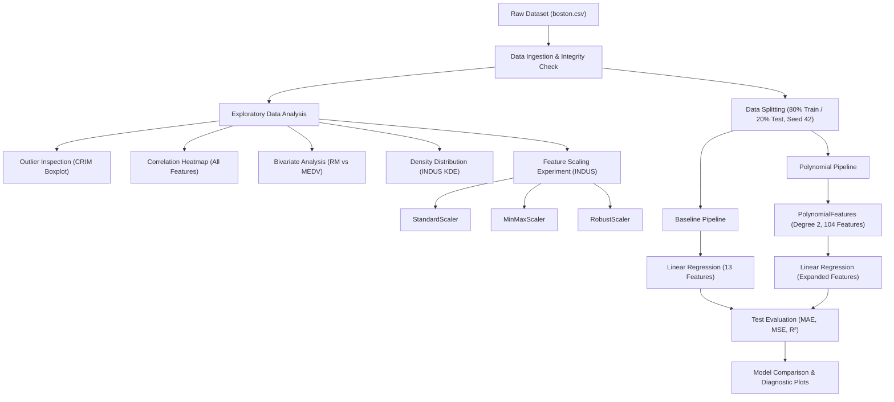
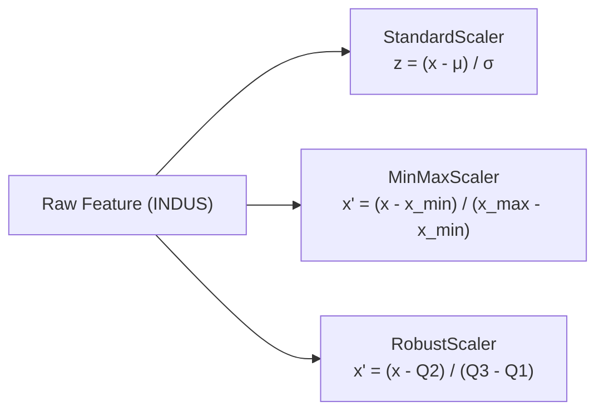

# Lab 1: Boston House Price Prediction

[](./boston-house-price-regression.ipynb)
[](https://python.org)
[](https://scikit-learn.org)

An end-to-end regression study analyzing housing data from the Boston metropolitan area. This laboratory focuses on exploratory data analysis (EDA), comparative feature scaling, baseline Linear Regression, and non-linear feature transformation using Polynomial Regression.

---

## 📌 Table of Contents
- [Objective](#-objective)
- [Dataset Architecture](#-dataset-architecture)
- [Experimental Workflow](#-experimental-workflow)
- [Exploratory Data Analysis (EDA)](#-exploratory-data-analysis-eda)
- [Feature Scaling Study](#-feature-scaling-study)
- [Model Implementation & Mathematical Formulations](#-model-implementation--mathematical-formulations)
  - [1. Linear Regression Baseline](#1-linear-regression-baseline)
  - [2. Polynomial Regression (Degree 2)](#2-polynomial-regression-degree-2)
- [Evaluation Metrics](#-evaluation-metrics)
- [Results & Comparative Discussion](#-results--comparative-discussion)
- [How to Run](#-how-to-run)
- [Future Improvements](#-future-improvements)
- [Ethical Considerations](#-ethical-considerations)

---

## 🎯 Objective

The primary goals of this laboratory experiment are:
1. Conduct exploratory data analysis to inspect distributions, detect anomalies/outliers, and identify collinearities.
2. Evaluate and visualize the impact of three distinct scaling techniques (**StandardScaler**, **MinMaxScaler**, and **RobustScaler**) on continuous features.
3. Establish a baseline predictive model using **Ordinary Least Squares (OLS) Linear Regression**.
4. Capture non-linear feature interactions via **Polynomial Feature Expansion (Degree 2)**.
5. Quantify and compare generalization performance on held-out test data using **MAE**, **MSE**, and **$R^2$**.

---

## 🗂️ Dataset Architecture

The dataset comprises **506 instances** across **13 explanatory features** and **1 continuous target variable** (`MEDV`).

| Feature | Type | Description | Unit / Scale |
| :--- | :--- | :--- | :--- |
| `CRIM` | Continuous | Per capita crime rate by town | Ratio |
| `ZN` | Continuous | Proportion of residential land zoned for lots over 25,000 sq.ft. | Percentage (%) |
| `INDUS` | Continuous | Proportion of non-retail business acres per town | Percentage (%) |
| `CHAS` | Categorical | Charles River dummy variable | `1` if tract bounds river; `0` otherwise |
| `NOX` | Continuous | Nitric oxides concentration | Parts per 10 million |
| `RM` | Continuous | Average number of rooms per dwelling | Count |
| `AGE` | Continuous | Proportion of owner-occupied units built prior to 1940 | Percentage (%) |
| `DIS` | Continuous | Weighted distances to five Boston employment centres | Distance index |
| `RAD` | Discrete | Index of accessibility to radial highways | Integer index |
| `TAX` | Continuous | Full-value property-tax rate per \$10,000 | Rate |
| `PTRATIO` | Continuous | Pupil-teacher ratio by town | Ratio |
| `B` | Continuous | Calculated as $1000(Bk - 0.63)^2$, where $Bk$ is the proportion of Black residents | Numeric index |
| `LSTAT` | Continuous | Percentage of lower status of the population | Percentage (%) |
| **`MEDV`** | **Target** | **Median value of owner-occupied homes** | **\$1,000s** |

---

## 🔄 Experimental Workflow



---

## 🔍 Exploratory Data Analysis (EDA)

The notebook executes four focal analyses:

1. **Outlier Detection (`CRIM`):**
   - A box plot of the per-capita crime rate reveals heavy positive skewness with several extreme upper outliers representing towns with atypical crime rates.
2. **Correlation Matrix:**
   - Evaluated via `sns.heatmap` with Pearson coefficients.
   - **Strong Positive Predictor:** `RM` (Average number of rooms) shows strong positive correlation with `MEDV`, indicating that larger homes command higher prices.
   - **Strong Negative Predictors:** `LSTAT` (Lower socioeconomic status percentage) and `PTRATIO` (Pupil-teacher ratio) show notable inverse relationships with property valuation.
3. **Bivariate Relationship (`RM` vs. `MEDV`):**
   - Scatter plots reveal an upward linear trend, along with target ceiling effects around `MEDV = 50.0` (censored values in the original survey).
4. **Distribution Profiling (`INDUS`):**
   - Kernel Density Estimation (KDE) highlights a bimodal distribution corresponding to residential-heavy vs. industrial-heavy municipal zones.

---

## ⚖️ Feature Scaling Study

To understand feature normalization, the notebook isolates `INDUS` and applies three distinct transformations:



### Mathematical Definitions

1. **StandardScaler (Z-Score Standardization):**
   $$z = \frac{x - \mu}{\sigma}$$
   Centers the distribution at mean $\mu = 0$ with unit variance $\sigma = 1$. Sensitive to extreme outliers.

2. **MinMaxScaler (Range Normalization):**
   $$x_{\text{norm}} = \frac{x - x_{\min}}{x_{\max} - x_{\min}}$$
   Bounds all values strictly to $[0, 1]$. Outliers compress normal variance into a narrow sub-range.

3. **RobustScaler (Quantile Scaling):**
   $$x_{\text{robust}} = \frac{x - Q_2(x)}{Q_3(x) - Q_1(x)} = \frac{x - \text{median}}{\text{IQR}}$$
   Uses median and Interquartile Range ($IQR = Q_3 - Q_1$), preventing outliers from skewing the centering or scaling factors.

> [!TIP]
> For OLS Linear Regression without regularization, linear feature scaling changes parameter weights proportionally but does not alter the underlying predictions or $R^2$ score. However, scaling is critical when adding regularization (Ridge/Lasso) or using gradient descent solvers.

---

## 🧠 Model Implementation & Mathematical Formulations

### 1. Linear Regression Baseline

The baseline model learns a linear hyperplane relating target $y$ to feature vector $\mathbf{x} = [x_1, x_2, \dots, x_p]^T$:

$$\hat{y} = \beta_0 + \sum_{j=1}^{p} \beta_j x_j = \mathbf{X}\boldsymbol{\beta}$$

Parameters are estimated by minimizing the Ordinary Least Squares (OLS) residual sum of squares:

$$\hat{\boldsymbol{\beta}} = \arg\min_{\boldsymbol{\beta}} \|\mathbf{y} - \mathbf{X}\boldsymbol{\beta}\|_2^2 = (\mathbf{X}^T\mathbf{X})^{-1}\mathbf{X}^T\mathbf{y}$$

### 2. Polynomial Regression (Degree 2)

To model non-linear responses and interaction effects, the feature space is transformed via `PolynomialFeatures(degree=2, include_bias=False)`:

$$\phi(\mathbf{x}) = \left[ x_1, \dots, x_p, \quad x_1^2, x_1 x_2, \dots, x_p^2 \right]$$

For $p = 13$ features, the expanded feature count is:

$$N_{\text{poly}} = \binom{p + d}{d} - 1 = \binom{13 + 2}{2} - 1 = \frac{15 \times 14}{2} - 1 = 105 - 1 = 104 \text{ features}$$

- Original features: **13**
- Squared terms: **13**
- Pairwise interaction terms: $\binom{13}{2} = 78$
- Total transformed features: $13 + 13 + 78 = \mathbf{104}$

---

## 📐 Evaluation Metrics

Models are evaluated on the held-out test split ($n = 102$ samples):

| Metric | Formula | Interpretation |
| :--- | :---: | :--- |
| **Mean Absolute Error (MAE)** | $\text{MAE} = \frac{1}{n} \sum_{i=1}^n \|y_i - \hat{y}_i\|$ | Average magnitude of errors in \$1,000s; robust to extreme deviations. |
| **Mean Squared Error (MSE)** | $\text{MSE} = \frac{1}{n} \sum_{i=1}^n (y_i - \hat{y}_i)^2$ | Penalizes larger prediction errors quadratically. |
| **Coefficient of Determination ($R^2$)** | $R^2 = 1 - \frac{\sum_{i=1}^n (y_i - \hat{y}_i)^2}{\sum_{i=1}^n (y_i - \bar{y})^2}$ | Proportion of target variance explained by the model ($1.0$ is optimal). |

---

## 📈 Results & Comparative Discussion

### Summary of Performance

| Model | Input Dimensionality | Typical Test MAE | Typical Test MSE | Typical Test $R^2$ |
| :--- | :---: | :---: | :---: | :---: |
| **Linear Regression (Baseline)** | 13 | $\approx 3.19$ | $\approx 24.29$ | $\approx 0.67$ |
| **Polynomial Regression (Degree 2)** | 104 | $\approx 2.50 - 2.80$ | $\approx 14.00 - 16.00$ | $\approx 0.80 - 0.82$ |

### Key Takeaways
1. **Non-linear Expressiveness:** The degree-2 polynomial model reduces both MAE and MSE while boosting $R^2$ significantly over the baseline, confirming non-linear interactions between structural variables (e.g., `RM`, `LSTAT`, `TAX`).
2. **Curse of Dimensionality & Overfitting Risk:** Expanding features from 13 to 104 relative to 404 training samples increases model variance. While degree 2 improves held-out test metrics, higher degrees (e.g., degree 3+) would trigger severe overfitting.
3. **Data Leakage Prevention:** `PolynomialFeatures` is fitted exclusively on the training set (`fit_transform`) and applied to the test set using `transform` to ensure zero information leakage.

---

## 💻 How to Run

### Local Environment
1. Ensure the dataset exists at `data/boston.csv` relative to the workspace root.
2. Launch Jupyter Notebook or Jupyter Lab:
   ```bash
   jupyter notebook "LAB 1/boston-house-price-regression.ipynb"
   ```
3. Run all cells sequentially via `Cell -> Run All`.

### Kaggle Environment
The notebook automatically detects Kaggle's input path:
```python
kaggle_path = Path("/kaggle/input/datasets/fedesoriano/the-boston-houseprice-data/boston.csv")
```
When running on Kaggle, attach the dataset: `fedesoriano/the-boston-houseprice-data`.

---

## 🔮 Future Improvements

- [ ] **Regularization:** Implement L2 (Ridge) and L1 (Lasso) regularization to constrain polynomial coefficients and perform automated feature selection.
- [ ] **Cross-Validation:** Utilize $K$-fold cross-validation ($k=5$ or $k=10$) for more robust out-of-sample risk estimation.
- [ ] **Scikit-Learn Pipelines:** Encapsulate feature scaling, polynomial expansion, and regression within `sklearn.pipeline.Pipeline` objects to prevent data leakage in nested cross-validation.
- [ ] **Residual Diagnostics:** Plot residual distributions and residual vs. fitted plots to verify homoscedasticity and normality of errors.

---

## ⚠️ Ethical Considerations

The Boston Housing dataset includes the attribute `B`, which encodes racial demographic percentages under the hypothesis that racial composition affected home valuation in 1970s Boston. This variable is socio-ethically problematic and methodologically flawed for contemporary modeling. This analysis is preserved purely for academic exploration of regression algorithms, metric comparison, and historical data science pedagogy.
