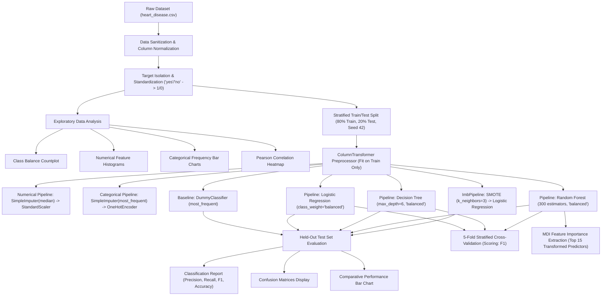

# Heart Disease Prediction

[](https://www.python.org/)
[](https://jupyter.org/)
[](https://scikit-learn.org/)
[](https://imbalanced-learn.org/)
[](https://pandas.pydata.org/)
[](https://numpy.org/)
[](https://opensource.org/licenses/MIT)

A machine learning classification pipeline designed to analyze clinical, demographic, and lifestyle-related health indicators to identify risk patterns associated with heart disease. Built with scikit-learn, this project implements a strict data-leakage-free preprocessing architecture, compares linear and tree-based ensembles, explores synthetic minority oversampling (SMOTE), and validates generalization through stratified cross-validation.

> **Research & Educational Disclaimer:** This repository is an academic machine learning study and technical demonstration. It is **not** a clinically validated diagnostic tool. The model predictions and feature associations must never be used as a substitute for professional medical evaluation, diagnosis, or treatment.

---

## Table of Contents

- [Project Overview](#project-overview)
- [Dataset Architecture](#dataset-architecture)
- [Repository Structure](#repository-structure)
- [Machine Learning Workflow](#machine-learning-workflow)
- [Algorithms & Modeling Strategy](#algorithms--modeling-strategy)
- [Evaluation Strategy & Clinical Metrics](#evaluation-strategy--clinical-metrics)
- [Model Performance & Experimental Results](#model-performance--experimental-results)
- [Visual Documentation](#visual-documentation)
- [Installation & Setup](#installation--setup)
- [Dataset Acquisition](#dataset-acquisition)
- [Key Engineering Takeaways](#key-engineering-takeaways)
- [Limitations & Ethical Considerations](#limitations--ethical-considerations)
- [Author](#author)

---

## Project Overview

Cardiovascular diseases (CVDs) remain the leading cause of mortality worldwide. Early screening and identification of contributing risk factors—ranging from physiological biomarkers to habitual lifestyle metrics—are central to preventative healthcare analytics.

This project investigates how supervised binary classification can identify multivariate patterns correlating with heart disease status. The primary technical objectives are:

1. **Systematic Data Sanitization:** Handle heterogeneous feature schemas containing continuous physiological measurements, discrete ordinal metrics, and categorical attributes.
2. **Leakage-Free Preprocessing:** Enforce strict encapsulation of feature imputation, standard scaling, and one-hot encoding within `scikit-learn` and `imbalanced-learn` pipelines fitted solely on training splits.
3. **Class Imbalance Mitigation:** Address class disproportion using algorithmic re-weighting (`class_weight="balanced"`) and synthetic minority oversampling (`SMOTE`).
4. **Comparative Analysis:** Benchmark multiple paradigms—linear models, shallow decision trees, and bagged random forests—against a majority-class dummy baseline.
5. **Interpretability & Feature Relevance:** Extract Gini feature importances to inspect which transformed features contribute most to ensemble classification decisions.

---

## Dataset Architecture

The underlying dataset is sourced from Kaggle: [Heart Disease – Heart Disease Data for Health Research](https://www.kaggle.com/datasets/oktayrdeki/heart-disease) by Oktay Rdeki.

The dataset contains **20 explanatory variables** spanning physiological measurements, laboratory test results, behavioral patterns, and demographic profiles, alongside **1 binary target variable** (`Heart Disease Status`), yielding **21 columns total**.

### Feature Dictionary

| Feature | Category | Data Type | Description / Scale |
| :--- | :--- | :--- | :--- |
| `Age` | Demographic | Continuous | Patient chronological age (years) |
| `Gender` | Demographic | Categorical | Biological sex (`Male`, `Female`) |
| `Blood Pressure` | Clinical | Continuous | Systolic blood pressure measurement (mmHg) |
| `Cholesterol Level` | Clinical | Continuous | Total serum cholesterol level (mg/dL) |
| `Exercise Habits` | Behavioral | Categorical | Frequency of physical activity (`Low`, `Medium`, `High`) |
| `Smoking` | Behavioral | Categorical | Current or habitual smoking status (`Yes`, `No`) |
| `Family Heart Disease` | Medical History | Categorical | Family history of cardiovascular disease (`Yes`, `No`) |
| `Diabetes` | Clinical | Categorical | Diagnosed diabetes condition (`Yes`, `No`) |
| `BMI` | Clinical | Continuous | Body Mass Index ($kg/m^2$) |
| `High Blood Pressure` | Clinical | Categorical | Diagnostic hypertension indicator (`Yes`, `No`) |
| `Low HDL Cholesterol` | Clinical | Categorical | Low high-density lipoprotein indicator (`Yes`, `No`) |
| `High LDL Cholesterol` | Clinical | Categorical | Elevated low-density lipoprotein indicator (`Yes`, `No`) |
| `Alcohol Consumption` | Behavioral | Categorical | Self-reported alcohol intake (`None`, `Low`, `Medium`, `High`) |
| `Stress Level` | Behavioral | Categorical | Self-reported psychological stress level (`Low`, `Medium`, `High`) |
| `Sleep Hours` | Behavioral | Continuous | Average daily duration of sleep (hours) |
| `Sugar Consumption` | Dietary | Categorical | Habitual dietary sugar intake (`Low`, `Medium`, `High`) |
| `Triglyceride Level` | Biomarker | Continuous | Blood serum triglyceride level (mg/dL) |
| `Fasting Blood Sugar` | Biomarker | Continuous | Fasting plasma glucose measurement (mg/dL) |
| `CRP Level` | Biomarker | Continuous | C-Reactive Protein level; systemic inflammation marker (mg/L) |
| `Homocysteine Level` | Biomarker | Continuous | Plasma homocysteine amino acid concentration ($\mu mol/L$) |
| **`Heart Disease Status`** | **Target** | **Binary** | **Primary target variable (`Yes`: 1, `No`: 0)** |

*Note: Dimensions and sample counts are dynamically validated upon CSV ingestion using `data.shape` to support arbitrary dataset releases.*

---

## Repository Structure

Within the overarching laboratory workspace, this module constitutes **LAB 2**:

```text
heart-disease-prediction/
│
├── heart-disease-prediction.ipynb    # Main pipeline notebook (data prep, training, eval)
├── requirements.txt                  # Strict environment dependency specifications
└── README.md                         # Detailed project documentation
```

### Module Roles
- **`heart-disease-prediction.ipynb`**: The self-contained computational notebook containing the complete machine learning workflow: exploratory analysis, custom transformer pipelines, baseline comparisons, cross-validation, and diagnostic plots.
- **`requirements.txt`**: Pinned dependency list guaranteeing reproducible execution across local virtual environments and cloud containers.
- **`README.md`**: Architectural and operational documentation detailing implementation rationale, metric definitions, and execution guidelines.

---

## Machine Learning Workflow

The end-to-end modeling pipeline is architected around scikit-learn's `Pipeline` and `ColumnTransformer` modules to guarantee zero data leakage between splits.



### Step-by-Step Execution Sequence

1. **Environment Setup & Configuration:** Imports core numerical and statistical libraries (`numpy`, `pandas`, `scikit-learn`, `imbalanced-learn`). Global random seed fixed (`RANDOM_STATE = 42`) for full determinism.
2. **Dynamic Dataset Loading:** Iterates through standard local (`data/heart_disease.csv`, `heart_disease.csv`) and Kaggle server paths (`/kaggle/input/...`) to load the dataset cleanly across environments.
3. **Data Hygiene & Schema Inspection:** Strips trailing whitespaces from column headers (`data.columns.str.strip()`), examines structural schema types via `data.info()`, and evaluates duplicate records (`data.duplicated().sum()`).
4. **Missing Value Auditing:** Aggregates and quantifies missingness across all features to determine suitable statistical imputation strategies.
5. **Target Sanitization & Validation:** Ensures the presence of `Heart Disease Status`, eliminates rows missing the target label, normalizes text (`str.lower()`), validates binary cardinality, and maps values to numeric representations (`no: 0`, `yes: 1`).
6. **Exploratory Data Analysis (EDA):** Profiles the target class distribution, visualizes numerical feature spreads via histogram grids, plots categorical value counts, and computes correlation matrices.
7. **Stratified Partitioning:** Divides data into 80% training and 20% testing partitions using `train_test_split(stratify=y, random_state=42)` to ensure identical class proportions across both splits.
8. **Preprocessing Pipeline Definition:**
   - **Numerical Pipeline:** Imputes missing values with column medians (`SimpleImputer(strategy="median")`) to withstand skewed features, followed by unit-variance standardization (`StandardScaler()`).
   - **Categorical Pipeline:** Fills missing values with the modal value (`SimpleImputer(strategy="most_frequent")`) and applies one-hot encoding (`OneHotEncoder(handle_unknown="ignore")`).
9. **Baseline Establishment:** Fits a `DummyClassifier(strategy="most_frequent")` to establish a minimum performance floor based solely on majority-class prevalence.
10. **Model Training:** Encapsulates preprocessing and estimator logic into individual `Pipeline` objects for:
    - Weighted Logistic Regression
    - Constrained Decision Tree
    - Random Forest Ensemble
11. **Comprehensive Model Evaluation:** Computes multi-class classification metrics (Accuracy, Precision, Recall, F1-Score, ROC-AUC) on the held-out test split.
12. **Class Imbalance Mitigation with SMOTE:** Integrates `imblearn.over_sampling.SMOTE` inside an `ImbPipeline` ensuring synthetic interpolation is confined solely to training folds, eliminating data leakage.
13. **Stratified K-Fold Cross-Validation:** Executes 5-fold cross-validation (`StratifiedKFold`) measuring mean and standard deviation of F1-scores to evaluate generalization stability.
14. **Ensemble Feature Importance:** Inspects the Random Forest's Mean Decrease in Impurity (MDI) across transformed feature names to identify prominent risk indicators.

---

## Algorithms & Modeling Strategy

Four complementary modeling strategies are implemented, each addressing distinct aspects of tabular classification:

### 1. Dummy Classifier (Baseline)
- **Role:** Establishes the empirical lower performance bound.
- **Mechanism:** Predicts the most frequent class observed in the training partition regardless of input features.
- **Utility:** Prevents the "accuracy paradox" where an uninformative model on imbalanced data appears effective simply by predicting the majority class.

### 2. Logistic Regression (Cost-Sensitive)
- **Role:** Interpretable linear benchmark for binary classification.
- **Configuration:** `max_iter=2000`, `class_weight="balanced"`.
- **Utility:** Computes log-odds of heart disease as a linear combination of normalized features:
  $$P(Y=1 \mid \mathbf{x}) = \frac{1}{1 + e^{-\mathbf{w}^T \mathbf{x}}}$$
- **Strengths:** Computationally efficient, highly interpretable, provides calibrated probability estimates.
- **Limitations:** Cannot model complex non-linear decision boundaries or high-order feature interactions without manual feature engineering.

### 3. Decision Tree Classifier
- **Role:** Non-linear rule-based estimator.
- **Configuration:** `max_depth=6`, `class_weight="balanced"`, `random_state=42`.
- **Utility:** Partitions the feature space using orthogonal splits that maximize information gain or Gini impurity reduction.
- **Strengths:** Inherently handles non-linear relationships; depth regularization (`max_depth=6`) prevents arbitrary memorization.
- **Limitations:** High variance; single decision trees are prone to instability and sub-optimal greedy splits.

### 4. Random Forest Classifier
- **Role:** High-capacity bagged ensemble estimator.
- **Configuration:** `n_estimators=300`, `class_weight="balanced"`, `n_jobs=-1`, `random_state=42`.
- **Utility:** Aggregates predictions across 300 decorrelated decision trees, each trained on bootstrap samples with random feature sub-selection.
- **Strengths:** Significantly reduces model variance, captures intricate feature interactions, robust to noise, yields feature importance metrics.
- **Limitations:** Higher computational footprint; reduced direct interpretability relative to single linear models.

### 5. Logistic Regression with SMOTE
- **Role:** Algorithmic resampling approach to class imbalance.
- **Configuration:** `SMOTE(k_neighbors=3)` within `imblearn.pipeline.Pipeline`.
- **Mechanism:** Synthesizes novel minority-class instances along feature-space line segments connecting $k$-nearest neighbors:
  $$\mathbf{x}_{\text{new}} = \mathbf{x}_i + \lambda (\mathbf{x}_{zi} - \mathbf{x}_i), \quad \lambda \sim U(0, 1)$$
- **Strengths:** Balances class distribution in representation space without simple record duplication.
- **Limitations:** Can introduce label noise if minority examples border noisy or overlapping decision regions.

---

## Evaluation Strategy & Clinical Metrics

In healthcare screening and diagnostic triage, standard classification accuracy is inherently deceptive. If positive cases constitute a minority of observations, an uncalibrated model predicting negative for every patient can achieve high accuracy while failing entirely at its intended objective.

```text
                       Actual Positive (1)        Actual Negative (0)
Predicted Positive (1) [ True Positive (TP)  ]   [ False Positive (FP) ]  -> Precision = TP / (TP + FP)
Predicted Negative (0) [ False Negative (FN) ]   [ True Negative (TN)  ]
                              ↓
                    Recall = TP / (TP + FN)
```

### Metrics Implemented

- **Recall (Sensitivity):** $\frac{\text{TP}}{\text{TP} + \text{FN}}$  
  *Critical Focus in Healthcare.* Measures the proportion of actual heart disease cases correctly flagged. A false negative (classifying an at-risk individual as healthy) carries severe clinical risk, making high recall paramount during preliminary screening.
- **Precision (Positive Predictive Value):** $\frac{\text{TP}}{\text{TP} + \text{FP}}$  
  Measures the proportion of predicted heart disease cases that are truly positive. Low precision results in false alarms and unnecessary follow-up interventions.
- **F1-Score:** $2 \cdot \frac{\text{Precision} \cdot \text{Recall}}{\text{Precision} + \text{Recall}}$  
  The harmonic mean of precision and recall, serving as the primary ranking metric for model comparison.
- **Accuracy:** $\frac{\text{TP} + \text{TN}}{\text{TP} + \text{TN} + \text{FP} + \text{FN}}$  
  The raw proportion of correct classifications across both classes.
- **ROC-AUC Score:**  
  Quantifies the model's ability to rank positive instances higher than negative instances across all discrimination thresholds, independent of class prevalence.
- **Confusion Matrix:**  
  Provides full visibility into exact counts of True Positives, False Positives, True Negatives, and False Negatives.

---

## Model Performance & Experimental Results

The notebook includes full evaluation scripts reporting held-out test set performance and 5-fold stratified cross-validation.

### Test Set Performance Summary

*Execute the notebook cells to populate the quantitative results on your specific dataset split.*

| Model Architecture | Test Accuracy | Test Precision | Test Recall | Test F1-Score | Test ROC-AUC |
| :--- | :---: | :---: | :---: | :---: | :---: |
| **Dummy Baseline (Most Frequent)** | *Pending Run* | *Pending Run* | *Pending Run* | *Pending Run* | *N/A* |
| **Logistic Regression (Balanced)** | *Pending Run* | *Pending Run* | *Pending Run* | *Pending Run* | *Pending Run* |
| **Decision Tree (max_depth=6)** | *Pending Run* | *Pending Run* | *Pending Run* | *Pending Run* | *Pending Run* |
| **Random Forest (300 Trees)** | *Pending Run* | *Pending Run* | *Pending Run* | *Pending Run* | *Pending Run* |
| **Logistic Regression + SMOTE** | *Pending Run* | *Pending Run* | *Pending Run* | *Pending Run* | *Pending Run* |

### Stratified 5-Fold Cross-Validation (Training Partition)

Cross-validation assesses stability across different random resamplings:

| Model Architecture | Mean CV F1-Score | CV F1 Std. Deviation |
| :--- | :---: | :---: |
| **Logistic Regression (Balanced)** | *Pending Run* | *Pending Run* |
| **Decision Tree (max_depth=6)** | *Pending Run* | *Pending Run* |
| **Random Forest (300 Trees)** | *Pending Run* | *Pending Run* |

> **Execution Note:** To populate this benchmark table with exact empirical scores, run all cells in `heart-disease-prediction.ipynb`. Results are dynamically aggregated into the `results_df` and `cv_results` DataFrames.

---

## Visual Documentation

The pipeline generates analytical visualizations across data exploration, evaluation, and interpretability phases. 

### 1. Target Class Distribution
Inspects class prevalence (`Yes` vs. `No`) to detect the presence and severity of class imbalance.
```text
Plot: sns.countplot(data=data, x='Heart Disease Status')
```

*(Placeholder: Run EDA Section 6 to generate and save figure)*

---

### 2. Numerical Feature Distributions
Generates a multi-panel histogram grid across all numeric predictors to evaluate skewness, modality, and extreme values.
```text
Plot: data[numeric_columns].hist(figsize=(16, 12), bins=25)
```

*(Placeholder: Run EDA Section 6 to generate and save figure)*

---

### 3. Numerical Correlation Matrix
A Pearson correlation heatmap analyzing pairwise linear collinearities among biomarkers, vital signs, and physical indicators.
```text
Plot: sns.heatmap(data[numeric_columns].corr(), cmap="coolwarm", center=0)
```

*(Placeholder: Run EDA Section 6 to generate and save figure)*

---

### 4. Confusion Matrix Displays
Side-by-side confusion matrices for each trained model, illustrating the trade-off between False Negatives and False Positives.
```text
Plot: ConfusionMatrixDisplay.from_predictions(y_test, y_pred, cmap="Blues")
```

*(Placeholder: Run Evaluation Section 10 to generate and save figure)*

---

### 5. Multi-Metric Performance Comparison
A grouped bar chart comparing Accuracy, Precision, Recall, and F1-Score across all candidate models.
```text
Plot: results_df[['Accuracy', 'Precision', 'Recall', 'F1 Score']].plot(kind='bar')
```

*(Placeholder: Run Evaluation Section 10 to generate and save figure)*

---

### 6. Top 15 Feature Importances (Random Forest)
A horizontal bar chart ranking the top 15 features by Mean Decrease in Impurity (Gini importance) extracted from the trained Random Forest pipeline.
```text
Plot: importance.head(15).plot(kind="barh")
```

*(Placeholder: Run Section 13 to generate and save figure)*

---

## Installation & Setup

### Prerequisites
- Python 3.9, 3.10, or 3.11 installed
- Git CLI

### Windows Quickstart (Command Prompt / PowerShell)

1. **Clone the Repository:**
   ```bash
   git clone https://github.com/anirudhx07/Machine_Learning_LAB.git
   cd Machine_Learning_LAB\LAB 2
   ```

2. **Create a Dedicated Virtual Environment:**
   ```powershell
   python -m venv venv
   ```

3. **Activate the Environment:**
   ```powershell
   # In PowerShell:
   .\venv\Scripts\Activate.ps1

   # In Command Prompt (cmd.exe):
   .\venv\Scripts\activate.bat
   ```

4. **Install Required Packages:**
   ```powershell
   pip install --upgrade pip
   pip install -r requirements.txt
   ```

5. **Launch Jupyter Notebook:**
   ```powershell
   jupyter notebook heart-disease-prediction.ipynb
   ```

---

## Dataset Acquisition

The notebook is configured to load the dataset automatically from standard local or Kaggle directories.

### Kaggle Environment
If executing inside a Kaggle Notebook, attach the dataset directly:
- **Dataset Slug:** `oktayrdeki/heart-disease`
- **Path Resolution:** The notebook automatically checks `/kaggle/input/datasets/oktayrdeki/heart-disease/heart_disease.csv`.

### Local Development Environment
1. Download the dataset from Kaggle: [Heart Disease Data for Health Research](https://www.kaggle.com/datasets/oktayrdeki/heart-disease).
2. Extract the file as `heart_disease.csv`.
3. Place it in one of the following supported locations relative to the notebook:
   ```text
   LAB 2/
   ├── data/
   │   └── heart_disease.csv
   └── heart_disease.csv
   ```
4. The notebook's `DATA_PATHS` loader will automatically resolve the file upon execution.

---

## Key Engineering Takeaways

- **Strict Prevention of Data Leakage:** Preprocessing transformations (median imputation, scaling factors, one-hot category vocabularies) are learned exclusively from the training split and applied to the test set via fitted transformers.
- **Leak-Free Synthetic Oversampling:** SMOTE is implemented within `imblearn.pipeline.Pipeline`, ensuring that synthetic interpolation occurs strictly inside the training folds and never touches validation or test records.
- **Handling Asymmetric Classification Costs:** Demonstrates how tuning `class_weight="balanced"` shifts the classification boundary to favor sensitivity (recall), mitigating the diagnostic risks associated with false negatives.
- **Stratified Resampling:** Employs `StratifiedKFold` to preserve minority class proportions across all cross-validation folds, yielding reliable out-of-fold generalization estimates.
- **Model Explainability Limits:** Acknowledges that Random Forest Gini feature importances identify predictive associations within this specific sample, but do not imply causal clinical relationships.

---

## Limitations & Ethical Considerations

1. **Non-Clinical Context:** This pipeline is intended strictly for educational exploration and machine learning methodology benchmarking. It is **not** medical device software and should never inform clinical triage or patient management.
2. **Observational & Sampling Biases:** Tabular datasets collected from specific observational cohorts often suffer from selection bias, regional demographic skew, and unmeasured confounders.
3. **Absence of Longitudinal Depth:** The cross-sectional nature of the data restricts the model to static associations without tracking temporal progression or therapeutic intervention effects.
4. **Generalization Constraints:** Models trained on this dataset cannot be assumed to generalize across different healthcare systems, demographics, or geographic regions without external validation.

---

## Author

**Anirudh Kumar**  
*B.Tech in Computer Science Engineering (Artificial Intelligence & Machine Learning)*  
- **GitHub:** [@anirudhx07](https://github.com/anirudhx07)  
- **LinkedIn:** [Anirudh Kumar](https://www.linkedin.com/in/anirudhx07/)  
- **Repository:** [Machine_Learning_LAB](https://github.com/anirudhx07/Machine_Learning_LAB)

---

## License

This project is licensed under the [MIT License](https://opensource.org/licenses/MIT).
